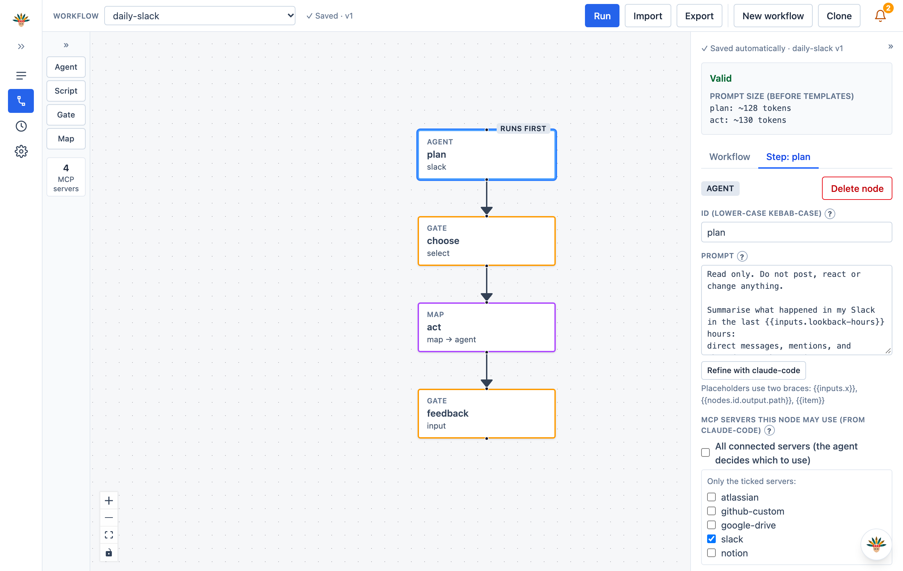
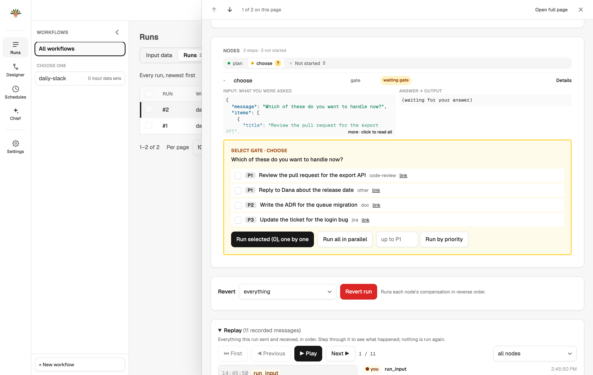
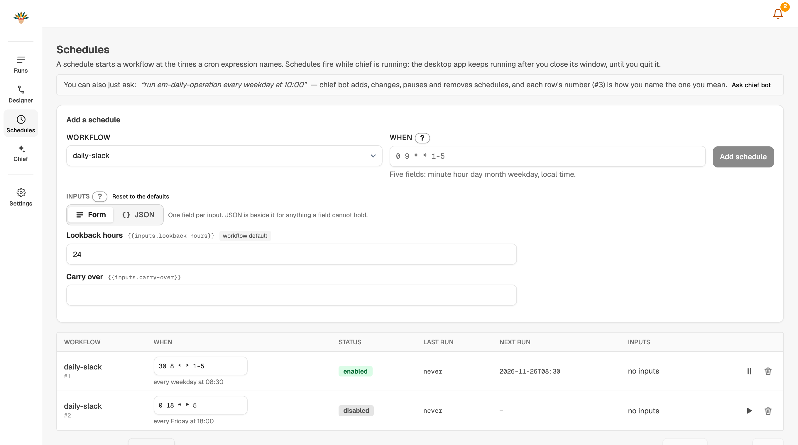
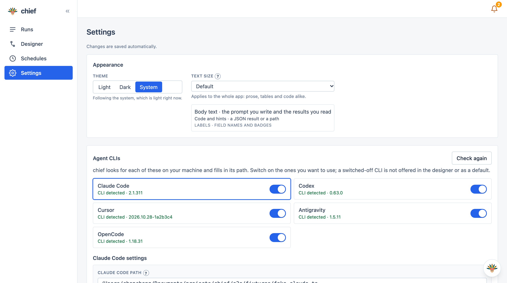
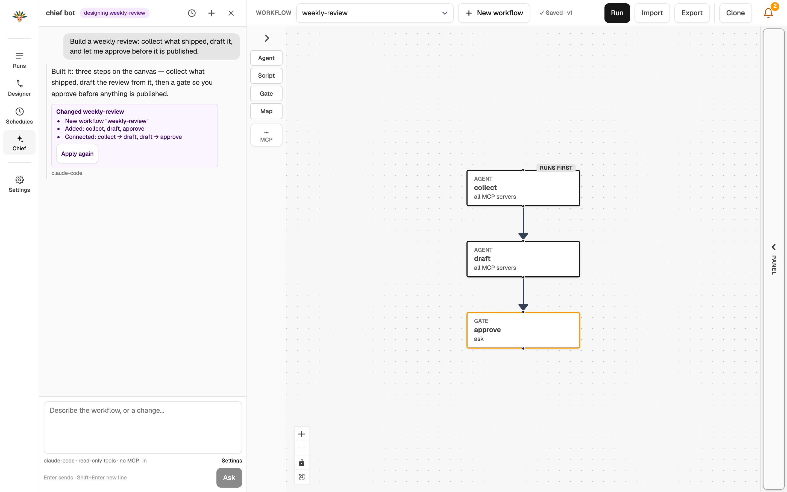
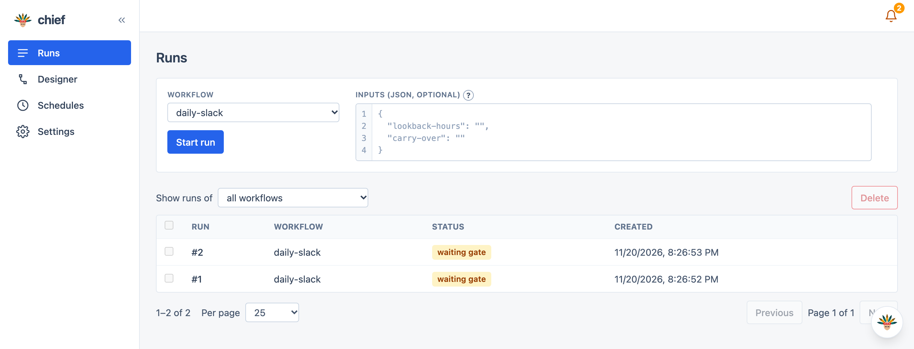
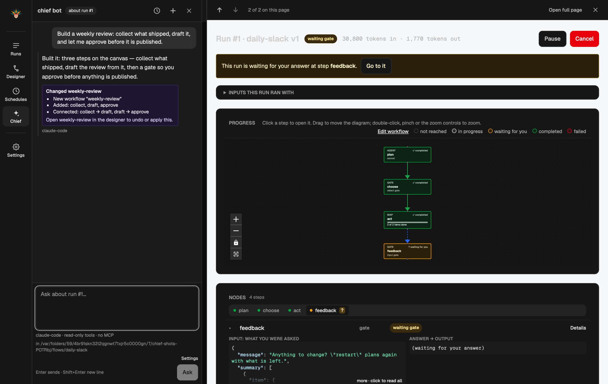

<p align="center">
  
</p>

# chief

chief runs workflows made of AI agents on your own machine, and stops to ask you before
anything you want to decide yourself.

<p align="center">
  <sub><b>WORKS WITH</b></sub><br>
   <b>Claude Code</b>
  &nbsp;·&nbsp; <b>Codex</b>
  &nbsp;·&nbsp;  <b>Cursor</b>
  &nbsp;·&nbsp; <b>Antigravity</b>
  &nbsp;·&nbsp;  <b>OpenCode</b>
  &nbsp;·&nbsp;  <b>Hermes</b>
</p>

The marks above are the vendors' own, shown to say which CLIs chief drives — see
[docs/logos](docs/logos/readme.md) for where each came from, and why Codex and Antigravity have none.

You draw a workflow as a small graph of steps: "read my Slack and list what I need to do", "ask
me which of these to handle", "do them", "write a report". chief runs the steps with the agent CLI
you already use (Claude Code, Antigravity or OpenCode; Codex, Cursor and Hermes experimentally), waits at the points where you want
a say, records everything that was sent and received, tracks what each step cost, and can undo
what a run changed. A step is whatever agent CLI you point it at: the six adapters today are coding
agents plus Hermes Agent, and another adapter needs nothing in the engine.

- **chief owns** the workflow, the run, a full record of every run, the questions to you (gates),
  token and cost accounting, and pause, resume and revert.
- **The agent CLI owns** model access, connections to other services through MCP servers (Slack,
  GitHub, Jira, Google Drive, …) and running tools. chief has no MCP configuration of its own: it
  uses the servers your CLI is connected to and only tells the CLI which of them a step may use.
- **Everything is local.** One process and one SQLite file. No cloud service, no account.

| Design a workflow | Answer a gate while it runs |
|---|---|
| [](docs/screenshots/designer.png) | [](docs/screenshots/run-gate.png) |
| **Schedules** | **Settings** |
| [](docs/screenshots/schedules.png) | [](docs/screenshots/settings.png) |

## Contents

- [Quick start](#quick-start)
- [The desktop app (macOS)](#the-desktop-app-macos)
- [chief bot](#chief-bot)
- [How a workflow is built](#how-a-workflow-is-built)
- [The web UI](#the-web-ui)
- [The command line](#the-command-line)
- [Where chief keeps things](#where-chief-keeps-things)
- [MCP servers](#mcp-servers)
- [Troubleshooting a run](#troubleshooting-a-run)
- [Safety model](#safety-model)
- [Limits worth knowing](#limits-worth-knowing)
- [Development](#development)
- [Changelog](#changelog)
- [License](#license)

## Quick start

You need:

- macOS. Script steps need the macOS sandbox; on Linux and Windows they are disabled.
- [Node](https://nodejs.org) 22.18 or newer (chief runs TypeScript directly and uses the built-in `node:sqlite`).
- At least one agent CLI, logged in, with the MCP servers you want to use: Claude Code 2.1.300 or
  newer (the default), Antigravity (`agy`), OpenCode, Hermes (`hermes`), Codex or Cursor
  (`cursor-agent`). Pick the
  default in Settings or with `chief settings set default-adapter '"opencode"'`; a workflow or a
  single step can choose another with `agent:`.

```sh
npm install
npm run build:web            # builds the web UI once
npm run chief doctor         # checks the agent CLIs, the database and the sandbox
npm run chief serve          # the web UI on http://127.0.0.1:8080, opened in your browser
```

Open <http://127.0.0.1:8080>, go to **Designer**, press **New workflow** and give it a name, then
drag an **Agent** block onto the canvas and type what it should do. Add a **Gate** after it if you want to be asked
something, connect the blocks, and press **Run**.

To start from an example instead:

```sh
npm run chief workflow import examples/daily-slack.yaml
npm run chief run daily-slack
```

`npm run build` makes one bundle at `dist/chief.mjs`, with the web UI inside it and the SQL migrations
beside it in `dist/migrations/`. Run it with `node dist/chief.mjs <command>`; put a small wrapper on your
`PATH` if you want to type `chief`. The rest of this page writes `chief`.

## The desktop app (macOS)

There is a one-page site with the screenshots and the download:
**<https://ccwukong.github.io/chief/>**.

The same chief in a window of its own, for people who would rather not open a terminal. It is not a
second implementation: the app starts the same server `chief serve` runs, on the Node that comes with
Electron, and shows the web UI in a window. You do not need Node installed to use it (script steps
written in JavaScript or TypeScript still call `node` from your PATH).

**Install.** Download the newest `chief-<version>-apple-silicon.dmg` from the
[releases page](https://github.com/ccwukong/chief/releases) (Apple silicon), with its `.sha256` beside
it. Each release is one version, named for it — `chief-0.2.0-apple-silicon.dmg` — and it is published
automatically when the version in `packages/desktop/package.json` goes up on `main`; raising the
version is the decision to ship, so a README fix or a refactor ships no new build. Open the file: the
installer window says **chief — drag to Applications**, shows **chief** on the left and an **Applications**
shortcut on the right, and draws the sentence and an arrow behind them — drag chief onto the shortcut.
The app is **not signed or notarized** (that needs an Apple
Developer account), so the first time macOS refuses to open it with a message that it cannot be
verified. That warning is expected: it says who made the app is unknown to Apple, not that the app is
damaged. Clear it once, in a terminal:

```sh
xattr -dr com.apple.quarantine /Applications/chief.app
```

and open the app again. An app you build yourself (below) does not carry the flag and opens at once.

- **The same data as the command line.** It reads `~/.chief`, so `chief serve` in a terminal and the
  app show the same workflows and runs. Run one of them at a time if you use schedules: each has its own
  scheduler. Its own log is `~/.chief/logs/chief.log` (menu
  **Help → Reveal Log in Finder**), and **Help → Copy Diagnostics** puts the versions, the paths and
  the page on show on the clipboard for a bug report.
- **Your agent CLIs are found for you.** Settings › Agent CLIs shows each one as a card: whether
  chief found it, its version, and a switch. The path is filled in when chief finds the program, so
  there is nothing to type; the field is only there to correct a path or to point at a CLI that was
  not found. A switch that is off removes the CLI from every picker, so a company CLI on a personal
  machine is never offered by accident. (The app also asks your login shell for its environment once,
  so a CLI installed through your shell profile is found when the app is opened from the Finder.)
- **Schedules fire while chief runs, and chief keeps running.** Closing the window does not quit: the
  app stays in the Dock with its server, its schedules and its runs alive until you quit it (⌘Q, or
  right-click the Dock icon). A run in progress keeps going with no window open; reopening from the
  Dock shows the same page. Quitting asks first when a run is in flight.
- **The web version is unchanged.** `chief serve` and the browser work exactly as before. A run belongs
  to the server, not to the tab: closing the tab never stops one, and while `chief serve` runs the
  server notifies you when a gate is waiting.
- **It tells you when there is a newer version.** On launch the app asks GitHub for the newest release
  — the one request it makes on its own — and offers it: **Download and Open** fetches the `.dmg` into
  Downloads and opens the installer, so updating is the same drag onto Applications as the first
  install. There is no silent self-replacement: macOS only lets a signed, notarized app update itself,
  and chief is neither. **Check for Updates…** in the chief menu asks again at any time, and
  `CHIEF_NO_UPDATE_CHECK=1` stops the launch check. Your workflows, runs and settings are in
  `~/.chief` and are untouched by an update.

To build the app and the `.dmg` yourself:

```sh
npm install
npm run build:desktop     # dist/chief.app and dist/chief.dmg
```

See [docs/desktop.md](docs/desktop.md) for what the build does.

## chief bot

**Talk to it and a workflow appears.** The chief logo in the bottom right corner of every page opens
chief bot. In the designer, say what the workflow should do — "collect what shipped this week, draft a
review, let me approve it before it goes out" — and it answers and builds it: the steps, their prompts
and the arrows appear on the canvas as you talk, so there is nothing to drag around. When a choice is
open it offers a few options to pick from, and you can always type your own instead.

**Ask it what went wrong.** On a run's page, "what went wrong, and what should I do next?" is answered
from that run's own record: the step, the error, the cause in a few lines, and the next move. Elsewhere
it knows your workflows, the recent runs and the gates waiting for you ("which runs failed, and why?",
"what is waiting for me?"). Also on the command line: `chief runs ask <id> "<question>"`.

It **runs nothing and changes nothing during a run**: it writes workflows and their schedules before a run
and reads records after one, with no tools and no MCP servers of its own. Every change it makes to a
workflow is listed under its answer with Undo.

A schedule is part of authoring too: in the designer, "run this every weekday at 9am" adds one, and
"pause it" or "make it 6pm instead" changes it. chief checks the expression and the workflow's inputs with
the same check the Schedules form gets, and writes it the same way — so a schedule it wrote behaves
exactly like one added by hand.



## How a workflow is built

| Concept | What it is |
|---|---|
| **Workflow** | Steps (nodes) and the arrows between them: a graph without cycles. Stored as YAML or JSON |
| **Inputs** | Values a workflow is given when it runs, used in prompts as `{{inputs.params.prlink}}` (any depth). A run gives a JSON object of the same shape; the workflow can hold defaults. One workflow, many configurations |
| **Agent step** | Runs the agent CLI with your prompt. Each step is its own session; it is given the results of the steps before it |
| **Script step** | Runs a local script in a sandbox. Its input arrives on stdin |
| **Gate** | The run waits for you. Either describe in plain words what you want to be asked (`ask`: a form is worked out from your instruction and the earlier results), or use a fixed form: pick from a list, approve, or type feedback |
| **Map** | Repeats a step for every item of a list |
| **Run** | One execution of a workflow. It can be paused, resumed, cancelled and reverted |
| **Side effect** | A write a step reports (a comment posted, a document created). `chief revert` works from this list |
| **Run record** | Everything a run sent and received, in order. Kept for every run |

Three things that are easy to get wrong:

- **A step cannot ask you anything while it works.** Only a gate can. If you want to choose
  between options, put an `ask` gate after the step that produces them.
- **A step knows only the results of the steps directly before it**, unless you set it to know all
  earlier steps. A gate's result is your answer.
- **There is no task database to set up.** chief stores every step's result and passes it on.

Writing workflows is covered in [docs/workflow-guide.md](docs/workflow-guide.md). Three examples
ship in [examples/](examples/); they differ only in where they start (Slack, GitHub, Jira).

## The web UI

`chief serve` starts it on <http://127.0.0.1:8080> (`--port n` for another port) and opens that page in your default browser (`--no-open` to skip; `CHIEF_BROWSER=<command>` to open it with another program).

- **Designer.** The bar at the top picks an existing workflow, runs it (**Run**), imports or exports
  it as YAML, makes a new one (**New workflow** opens a panel from the right) or copies the open one
  (**Clone**). The panel on the right has two tabs: the open workflow's settings and its inputs, and
  the selected step. On a laptop-sized window the designer makes room for the canvas by itself: the
  sidebar and the blocks shrink to slim rails and the panel appears when a step is selected. Drag blocks onto the
  canvas and connect them. Arrows show the order. The model and
  the MCP servers of a step are picked from what your agent CLI offers. **Refine** under a prompt
  asks the CLI to rewrite what you typed more clearly; you can go back to your own text. **Clone**
  copies the open workflow under a new name, so a small variation needs no dragging: rename the copy
  by typing a name, then change what differs. Its runs, schedules and script approvals are not
  copied. A step can also use a different agent CLI from the rest of the workflow (personal
  subscription for one step, work for the next); it then shows that CLI on the canvas. See
  ["One workflow, several agent CLIs"](docs/workflow-guide.md#one-workflow-several-agent-clis).
- **Runs.** Click a run in the list and it opens in a panel beside the list, so the list stays:
  another row or the arrow keys change the run, Escape closes it, and **Open full page** shows the
  run alone. **Run again** on a run starts a new run of the same workflow with the same inputs, for
  the next round of something like a pull request review. Start a run: pick the workflow and give the run's
  inputs as JSON; a run that lacks an input its prompts use is refused before it starts. The run page shows the
  run on the workflow's diagram, each step coloured by its status and the step in progress pulsing;
  click a step to open it. Below, the steps as rows: open one to read its prompt, its result and
  anything else it wrote. A gate is answered inside the step that is waiting. Finished runs can be
  deleted.
- **When a step fails**, for example because what it read did not fit in the model's context
  window, open it, pick another model or rewrite its prompt, and press **Resume**. Completed steps
  keep their results: only that step and the ones after it run again. Steps that have not started
  yet are listed under the others and can be changed the same way. Changes apply to that run only.
  If you fix the step in the designer instead, the run page says so and **Resume** uses the fixed
  version for the steps that have not completed.
  A step that stops to ask you something it cannot resolve can be changed the same way instead of
  answered, and a prompt you already fixed in the designer can be pulled into the run.
- **chief bot.** The chief logo in the bottom right corner of every page: see [chief bot](#chief-bot) above.
- **Schedules.** Every cron schedule with the workflow it starts, what its expression means, when it
  last fired and when it fires next, and its inputs; add one, disable one, remove one. Schedules fire
  while chief is running (see the desktop app above; with the CLI it is `chief serve`).
- **Replay.** Every message of a run, in order, for finding out what happened.
- **Settings.** The agent CLIs (each with a switch, and its path found for you), the default agent
  CLI, where workflow folders go, and **Appearance**: the theme (Light, Dark, System) and
  the text size (Small to Extra large). Everything saves itself — there is no Save button anywhere
  in the app.
- **Notifications.** The bell in the top right corner shows how many gates are waiting for you and
  lists them; each one opens its run.



A run open in the panel over the list, in the dark theme:



The screenshots use made-up data. `node e2e/tools/take-screenshots.mjs` takes them again from a
throw-away chief with the example workflow and stand-in agent CLIs.

There are no Save buttons: every change saves itself, and anything you are typing survives a page
refresh. In the designer a change is stored at once and becomes the workflow as soon as what is on
the canvas is valid; until then the last valid version is the one that runs.

While the server runs it prints a log in its terminal: requests that change something or fail,
runs and steps as they start, finish or fail, gates waiting for you, and each time it reads the
MCP servers. `CHIEF_LOG=debug chief serve` also shows every request the page makes.

## The command line

```sh
chief doctor                                   # checks the CLIs, the database and the sandbox
chief mcp list                                 # the MCP servers your agent CLI has in this folder
chief workflow import examples/daily-slack.yaml
chief run daily-slack                          # runs until the first gate
chief gate list                                # what is waiting for you
chief gate show 1
chief gate answer 1 '{"mode":"one-by-one","selected":[0,2]}'
chief runs show 1                              # steps, tokens, cost, side effects
chief runs replay 1                            # everything that was sent and received, in order
chief revert 1                                 # undo what the run changed, where possible
```

| Command | Purpose |
|---|---|
| `chief doctor` | Check agent CLIs, database, sandbox |
| `chief mcp list [--workflow <name>] [--cached]` | The MCP servers your agent CLI has right now, in this folder or a workflow's |
| `chief workflow import` / `export` / `validate` / `list` / `approve` / `rm` | Manage workflow definitions |
| `chief workflow clone <name> [<new-name>]` | Copy a workflow under a new name (default `<name>-copy`), without its runs, schedules or script approvals |
| `chief run <workflow>` | Start a run (`--input k=v`, `--input a.b=v` for a nested value, `--inputs-json`, `--warn-usd`, `--max-usd`) |
| `chief runs list [--workflow <name>] [--limit n] [--offset n]` / `show <id>` / `tail <id> [--follow]` | Inspect runs and their event log |
| `chief runs replay <id> [--node <id>] [--full]` | Play back the full record of a run (nothing is executed again) |
| `chief runs rerun <id>` | Run a run again: a new run of its workflow with the inputs that run ran with |
| `chief runs rm <id...>` | Delete finished runs and everything recorded for them |
| `chief runs set-model <run> <step> <model\|default>` | Change a step's model for this run while it is stopped, then `chief resume` |
| `chief runs set-prompt <run> <step> <text\|file>` | Change a step's prompt for this run while it is stopped, then `chief resume` |
| `chief models [--adapter a]` | The models the agent CLI offers |
| `chief pause` / `resume` / `cancel <id>` | Control a run. Resuming a failed run tries its failed steps again |
| `chief gate list` / `show` / `answer` / `approve` / `reject` | Answer gates |
| `chief revert <run> [--to <node>]` | Undo a run's side effects in reverse order |
| `chief schedule add` / `list` / `rm` / `enable` / `disable` | Cron schedules, without the app (the **Schedules** page does the same; they fire while `chief serve` runs) |
| `chief settings get` / `set` | Settings such as `default-budget`, `claude-code.path`, `notify` |
| `chief serve [--port n] [--no-open]` | HTTP API, web UI and scheduler on 127.0.0.1 (port 8080 by default); opens the web UI in the browser unless `--no-open` |

Add `--json` to any command for machine-readable output. Exit codes of `chief run`, `chief resume`
and `chief gate answer`: 0 when the run completed or is waiting, 1 when it failed, 2 when it was
cancelled.

## Where chief keeps things

Everything chief persists is in `~/.chief/`, outside any code checkout — the same idea as `~/.claude` or
`~/.codex`.

```
~/.chief/
  state/chief.db            all state: workflows, runs, the full record, gates, settings, drafts
  state/runs/               scratch folders of script steps
  workspace/<workflow>/     the folder each workflow's steps run in
  logs/chief.log            the desktop app's log of its server (the app only)
  desktop/                  Electron's own profile: cache and cookies (the app only)
```

- Cloning, moving or deleting the checkout never touches your workflows. Nothing a run writes can end
  up inside the repository.
- The desktop application uses the same folder, so it lists the same workflows and runs as `chief serve`.
- `CHIEF_HOME` points chief at another state folder; its workflow folders are then next to it.
- A workflow can name its own working directory, and the Workspace directory setting changes where new
  workflows get theirs.
- **Back it up if you care about the history.** Nothing else holds it, and deleting `~/.chief` deletes
  every workflow and run. `chief doctor` prints the path in use.
- The database has one schema per feature (workflow, run, agent, assistant, system, draft).

## MCP servers

chief does not configure MCP servers. Add them, remove them and sign in to them in the agent CLI
itself (Claude Code: `claude mcp` or the connector settings of your claude.ai account; Antigravity:
`agy mcp`; OpenCode: `opencode mcp` or its `opencode.json`; Hermes: `hermes mcp` or the
`mcp_servers:` key in `~/.hermes/config.yaml`; Codex: its `config.toml`; Cursor:
`.cursor/mcp.json`).

- Before every run and every resume, chief asks the CLI which servers it has and whether each is
  connected. For Claude Code this takes about two seconds.
- **The servers depend on the folder the agent runs in**: the workflow's working directory, or a
  step's own `cwd`. Claude Code's local-scope servers apply only to the exact folder they were added
  in, and a `.mcp.json` applies to its folder and those below it. chief asks the CLI in that folder,
  so a server you add for a workflow's folder (`cd <folder> && claude mcp add …`) is offered for that
  workflow only. The designer says which folder its list is for.
- By default an agent step may use every server the CLI is connected to, and the agent decides
  which ones a task needs. There is nothing to set up.
- A step can be restricted with `mcp:` to some servers (by the short name `chief mcp list` shows,
  such as `slack`, a unique prefix of it, or the CLI's own name) or to none (`mcp: []`). Do that
  for steps that must not be able to touch certain services, or to lower cost.
- If the CLI does not have a server a step names, or is not connected to it, the run does not
  start and you get that as the error, for example
  `claude-code is not connected to MCP server "claude.ai Notion": it needs authentication`.
- If a server stops working while a step runs, the step fails with the error the agent got. Fix
  the connection, then resume the run.

## Troubleshooting a run

Every run is recorded in full, as it happens: the exact prompt and command line sent to the agent
CLI, every reply, every tool call with its input and result, the stdin, stdout, stderr and exit
code of scripts, gate questions and your answers, status changes and errors.

- `chief runs replay <id>`, or the Replay section of a run in the web UI, plays that record back
  in order.
- On the run page, open a step to read its full prompt and result. Markdown is shown formatted,
  with a switch to the raw text. JSON results are shown parsed (field names beside values, text with
  its real line breaks, links clickable), with a switch to the JSON text.
- The terminal of `chief serve` shows steps failing as they fail, with the error.

The record contains whatever the agents read (for example Slack messages). It stays in
`~/.chief/state/chief.db` on your machine.

## Safety model

- **Agents can be scoped per step.** By default a step may use all MCP servers the agent CLI is
  connected to; listing servers in its `mcp:` field hides every other one from it (Cursor,
  Antigravity and Hermes can only be told which ones to use, see "Limits worth knowing"). By default
  it has none of the CLI's built-in tools (no shell, no file writes); Antigravity and OpenCode keep
  their read tools and run in their planning mode, which changes nothing, and **Hermes runs with
  whatever toolsets its own configuration enables** (Hermes has no per-run switch to turn them off;
  see "Limits worth knowing").
- **Agents ask before writing** when the prompt tells them to: the agent returns a question, chief
  opens a gate, and your answer resumes the same agent session.
- **Steps marked `irreversible`** need your confirmation before they run.
- **Script steps always run in a sandbox.** No network, and file operations only in the step's
  working directory and a scratch directory, unless the step widens this and you approve it.
  Credentials, chief's own data, shell start-up files and git hooks are never writable. There is no
  switch to turn the sandbox off. On platforms without a sandbox backend (Linux, Windows) script
  steps are disabled.
- **Budgets.** A workflow or a run can have a warning level and a hard limit in USD. At the limit
  the run stops and asks whether to continue.
- **The web server** listens on 127.0.0.1 only, has no login, and rejects requests whose `Host` or
  `Origin` is not its own address.

## Limits worth knowing

- **Codex, Cursor and Hermes adapters are unverified.** They were written from the vendors'
  documentation and tested against stand-in CLIs only. See [docs/adapters/](docs/adapters/).
- **Cursor, Antigravity and Hermes scope MCP servers by instruction only.** Their CLIs cannot hide a
  configured server for one run, so the step is told which servers it may use.
  Claude Code, Codex and OpenCode hide the other servers.
- **Hermes cannot be told to use no built-in tools.** Its documented `-t/--toolsets` only enables
  toolsets, and the enabled set is a property of its own `~/.hermes/config.yaml`; there is no
  per-run "none" and no read-only mode. A Hermes step therefore runs with whatever toolsets Hermes
  has enabled, including shell access if it has it. Use another CLI for steps where that matters.
- **Revert is best effort.** It runs the compensation each step declares. Effects marked
  irreversible, effects of steps without a compensation, and compensations that fail are listed for
  you to handle by hand.
- **Cost is what the CLI reports.** Claude Code and OpenCode report cost per call. Codex,
  Antigravity and Hermes report tokens only, Cursor reports nothing, so budgets do not limit those
  four.
- **Schedules need chief running.** The scheduler is inside `chief serve`; the desktop app keeps it
  running after you close the window (until Quit), and closing a terminal that started `chief serve`
  stops it.

## Development

See [AGENTS.md](AGENTS.md) for the development standard, [docs/dev-plan.md](docs/dev-plan.md) for
the plan and status, and [docs/e2e-test-plan.md](docs/e2e-test-plan.md) for the test cases.

```sh
npm run serve:dev    # the server, restarted when its source changes (rebuild the UI with npm run build:web)
npm run dev:desktop  # the desktop app with live reload: Vite HMR, the server on --watch, the app relaunched
npm run e2e          # Playwright e2e suite (uses a fake agent CLI; no tokens spent)
npm run typecheck
npm run lint
npm run build:desktop # the macOS app and its .dmg in dist/
npm run site         # the landing page, assembled into site/dist (npm run site:serve to look at it)
```

## Changelog

[CHANGELOG.md](CHANGELOG.md) lists every version, newest first, and what changed for the person using
chief. It is updated with the work, not afterwards: a version is written there in the change that
releases it.

## License

chief is licensed under the [Apache License, Version 2.0](LICENSE). The terms and the copyright notice
are in that file; nothing here repeats them.

**Nothing is guaranteed, and nothing is your fault but your own.** [TERMS.md](docs/terms.md) says that in
plain words: chief is provided as it is, with no warranty, and the author and contributors are not liable
for loss arising from using it — lost data, lost work, lost time. It also says what the licence already
says: nothing in those terms takes away a right Apache-2.0 grants you. The same page is on the site at
[ccwukong.github.io/chief/terms.html](https://ccwukong.github.io/chief/terms.html).

In plain words: use it, change it, run it at work, redistribute it, sell support around it. If you
redistribute it or a modified version, keep the license and the copyright notice, ship the notices of
the third-party packages it contains, and say what you changed. The Apache license also gives you a
patent grant from contributors, and it does not grant you the right to use the name "chief" or its logo.

The third-party notices are **generated by the build**, not kept in the repository: `npm run build`
writes `THIRD-PARTY-NOTICES.md` from `package-lock.json` next to the bundle, and the desktop app ships
it inside the app (`Contents/Resources/server/`). So a distributed copy carries the notices its licenses
require, and adding or removing a dependency needs no edit to any list.

**Contributions** are welcome under the same license, with one extra grant so the project keeps its
options open — please read the three points in [CONTRIBUTING.md](CONTRIBUTING.md) before opening a pull
request.
